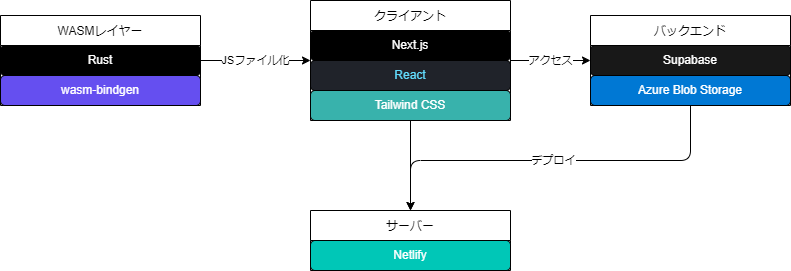

<div id="top"></div>

# WebImagePro

画像をネット上にアップロードし、加工・圧縮等の機能を利用することが出来るwebアプリです。

## 使用技術一覧

[](https://app.netlify.com/sites/webimagepro/deploys)

<p style="display: inline">
  <!-- フロントエンドフレームワーク -->
	<a href="https://nextjs.org/" target="_blank">
		
  </a>
	<a href="https://reactjs.org/" target="_blank">
    
  </a>
  <a href="https://tailwindcss.com/" target="_blank">
    
  </a>

  <!-- プログラミング言語 -->
  <a href="https://www.typescriptlang.org/" target="_blank">
    
  </a>
  <a href="https://www.rust-lang.org/" target="_blank">
    
  </a>

  <!-- バックエンド/データベース -->
  <a href="https://supabase.com/" target="_blank">
    
  </a>

  <!-- WebAssembly -->
  <a href="https://webassembly.org/" target="_blank">
    
  </a>
  <a href="https://github.com/rustwasm/wasm-bindgen" target="_blank">
    
  </a>

  <!-- テスト/開発ツール -->
  <a href="https://storybook.js.org/" target="_blank">
    
  </a>
  <a href="https://vitest.dev/" target="_blank">
    
  </a>
  <a href="https://playwright.dev/" target="_blank">
    
  </a>
</p>

## 環境

### アーキテクチャ図



## ディレクトリ構成

```sh
$ tree -a -I ".next|.storybook|.task|.vscode|node_modules|.git|target" -L 3 | sed 's/│/|/g; s/├──/|--/g; s/└──/`--/g' | sed 's/|--/├──/g'
.
├── .env.example
├── .env.local
├── .gitignore
├── README.md
├── Taskfile.yml
├── components.json
├── docs
|   |                                               `-- architecture.drawio
|                                                   `-- architecture.png
├── eslint.config.mjs
├── next-env.d.ts
├── next.config.ts
├── package-lock.json
├── package.json
├── postcss.config.mjs
├── public
|   |                                               `-- file.svg
|   |                                               `-- globe.svg
|   |                                               `-- next.svg
|   |                                               `-- vercel.svg
|                                                   `-- window.svg
├── src
|   |                                               `-- app
|   |   |                                           `-- api
|   |   |                                           `-- contact
|   |   |                                           `-- favicon.ico
|   |   |                                           `-- gallery
|   |   |                                           `-- globals.css
|   |   |                                           `-- layout.tsx
|   |   |                                           `-- login
|   |   |                                           `-- page.tsx
|   |   |                                           `-- privacy
|   |   |                                           `-- profile
|   |   |                                           `-- settings
|   |   |                                           `-- terms
|   |                                               `-- upload
|   ├── components
|   |   |                                           `-- ImageCliper.tsx
|   |   |                                           `-- ImageCliperControls.tsx
|   |   |                                           `-- ImageColorAjustment.tsx
|   |   |                                           `-- ImageComposition.tsx
|   |   |                                           `-- ImageEditor.tsx
|   |   |                                           `-- ImageFilter.tsx
|   |   |                                           `-- ImageGallery.tsx
|   |   |                                           `-- ImageList.tsx
|   |   |                                           `-- ImagePreviewList.tsx
|   |   |                                           `-- ImageResizer.tsx
|   |   |                                           `-- ImageTransform.tsx
|   |   |                                           `-- ImageUpload.tsx
|   |   |                                           `-- ImageUploadActions.tsx
|   |   |                                           `-- common
|   |   |                                           `-- form
|   |                                               `-- ui
|   ├── lib
|   |   |                                           `-- api.ts
|   |   |                                           `-- azure-storage.ts
|   |   |                                           `-- constants.ts
|   |   |                                           `-- stripe.ts
|   |   |                                           `-- supabase.ts
|   |                                               `-- utils.ts
|   ├── middleware.ts
|   ├── pkg
|   |   |                                           `-- .gitignore
|   |   |                                           `-- package.json
|   |   |                                           `-- wasm.d.ts
|   |   |                                           `-- wasm.js
|   |   |                                           `-- wasm_bg.wasm
|   |                                               `-- wasm_bg.wasm.d.ts
|   ├── providers
|   |                                               `-- ThemeProvider.tsx
|   ├── store
|   |                                               `-- useAuthStore.ts
|   `-- types
|       |                                           `-- types.ts
|                                                   `-- wasm-module.d.ts
├── tsconfig.json
├── vitest.config.ts
`-- wasm
    ├── .gitignore
    ├── Cargo.lock
    ├── Cargo.toml
    ├── fonts
    `-- src
        |                                           `-- brightness_adjustment
        |                                           `-- color_adjustment
        |                                           `-- color_conversion.rs
        |                                           `-- filter_effects
        |                                           `-- image_composition
        |                                           `-- image_operations
                                                    `-- lib.rs

30 directories, 60 files
```
<p align="right">(<a href="#top">トップへ</a>)</p>

## 開発環境構築

### リポジトリをクローンする
```sh
> git clone
```

### taskfileのインストール
```sh
> brew install taskfile
```

### クローンしたリポジトリを開き、パッケージをインストール
```sh
> npm install
```

### taskコマンドを実行し、wasmをビルド
```sh
> task build:wasm
```

### 開発サーバーの起動
```sh
> npm run dev
```

<p align="right">(<a href="#top">トップへ</a>)</p>